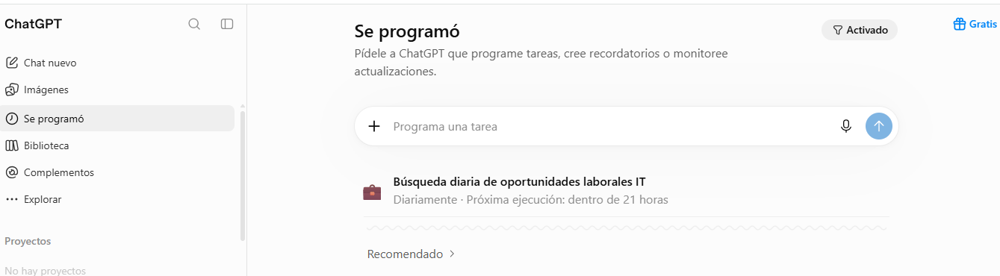

# AI IT Job Search Agent

Prototipo de agente de búsqueda laboral IT diseñado y configurado mediante ChatGPT.

El proyecto tiene como objetivo automatizar la búsqueda, evaluación y organización de oportunidades laborales de acuerdo con un perfil profesional definido.

## Objetivo

Facilitar la búsqueda de empleo mediante un flujo automatizado que permita identificar ofertas relevantes, evaluar su compatibilidad con el perfil del candidato y enviar un reporte diario por correo electrónico.

## ¿Cómo funciona?

El agente utiliza las funcionalidades de ChatGPT para:

1. Buscar oportunidades laborales en diferentes portales y sitios oficiales de empresas.
2. Identificar ofertas relacionadas con el perfil profesional configurado.
3. Evaluar la compatibilidad de cada oportunidad.
4. Filtrar por ubicación, modalidad de trabajo, seniority y antigüedad de publicación.
5. Detectar y evitar ofertas duplicadas.
6. Organizar los resultados según su nivel de compatibilidad.
7. Enviar un único reporte diario por correo electrónico.

## Perfil profesional de referencia

El agente está configurado para buscar oportunidades acordes a un perfil con formación y experiencia en:

- Desarrollo de software, frontend y aplicaciones web.
- React, JavaScript, C#, .NET y APIs REST.
- SQL Server, bases de datos relacionales y optimización de consultas.
- Formación en Ingeniería de Datos.
- Proyectos personales con Python, PostgreSQL, Docker, Kafka, Airflow y procesos ETL/ELT.
- Formación técnica en Programación y Química.

Los proyectos personales de Ingeniería de Datos se consideran experiencia práctica y formativa, no experiencia laboral profesional en esa especialidad.

## Categorías de búsqueda

### Ingeniería de Datos

- Data Engineer Junior.
- ETL / ELT Developer.
- Python / SQL Developer.
- Data Integration.
- Bases de datos y procesamiento de datos.
- Data Warehousing y pipelines.

### Desarrollo de Software

- Software Developer Semi Senior.
- .NET / C# Developer.
- Backend Developer.
- Frontend Developer.
- Full Stack Developer.
- Desarrollo de APIs.

## Criterios de selección

- Ofertas publicadas dentro de los últimos 15 días.
- Publicaciones activas y verificables.
- Oportunidades presenciales, híbridas o remotas en San Francisco y localidades cercanas.
- Para otras localidades de Argentina, únicamente posiciones 100 % remotas que permitan trabajar desde cualquier provincia.
- Para oportunidades internacionales, contratación habilitada para residentes en Argentina.
- Evaluación de compatibilidad entre 0 y 100 %, con fortalezas y brechas identificadas.

## Automatización

La búsqueda está configurada para ejecutarse diariamente a las **05:00 (hora de Argentina)** mediante las tareas programadas de ChatGPT.

El sistema prepara un único correo diario con las oportunidades nuevas encontradas, organizadas por categoría y nivel de compatibilidad.

También contempla el envío de un aviso cuando no se detectan nuevas oportunidades relevantes.

## Estructura del repositorio

```text
ai-it-job-search-agent/
│
├── README.md
│
├── docs/
│   ├── agent-design.md
│   └── workflow.md
│
├── prompts/
│   └── job_search_agent.md
│
├── examples/
│   └── sample_report.md
│
└── automatizacion-chatgpt.png
```

## Herramientas utilizadas

- ChatGPT.
- Tareas programadas de ChatGPT.
- Búsqueda web.
- Gmail para la entrega de reportes.
- Git y GitHub para documentar y versionar el proyecto.

## Alcance del proyecto

Este repositorio documenta el diseño, las instrucciones, los criterios de búsqueda y el flujo de funcionamiento de un prototipo de agente implementado mediante ChatGPT.

No es una aplicación independiente ni una integración desarrollada mediante una API propia. La interpretación de instrucciones, las búsquedas, el análisis y la automatización se realizan utilizando las funcionalidades disponibles en ChatGPT.

## Evidencia de configuración

La siguiente captura muestra la configuración de la automatización en ChatGPT:



## Autor

Proyecto personal de experimentación y aplicación práctica de Inteligencia Artificial en la automatización de procesos de búsqueda laboral.
